# Vienna POI Explorer

A native iOS app built with SwiftUI for exploring Vienna's sightseeing points of interest using the city's official open data.

## Project structure

- `poi-vienna-explorer/App/`: app entry point
- `poi-vienna-explorer/AppState/`: catalogue loading state
- `poi-vienna-explorer/Models/`: domain models
- `poi-vienna-explorer/Services/`: data service interfaces
- `poi-vienna-explorer/Views/`: SwiftUI screens, including the POI map destination
- `poi-vienna-explorer/Assets.xcassets/`: app icon and categorized branding, icon, marker, and UI image sets
- `poi-vienna-explorerTests/`: unit tests
- `poi-vienna-explorerUITests/`: UI tests

Open `poi-vienna-explorer.xcodeproj` in Xcode and run the `poi-vienna-explorer` scheme on an iOS simulator or device. The deployment target is iOS 17.0.

## Branding assets

The visual assets live in `Assets.xcassets` under `Branding`, `Icons`, `Markers`, and `UI`:

- **Used on screen today:** The Explore home screen pairs the Vienna POI Explorer banner and browse card with the City of Vienna Open Data badge, while the list and map callouts use the custom refresh and details graphics.
- **Ready for future expansion:** The catalog also holds category markers (transit, parking, EV charging) and status indicators. Since Vienna's sightseeing dataset only covers landmarks without transport or live status data, those stay on the shelf for now.
- **App icon:** The rounded icon graphic is included in `Branding` as concept artwork rather than assigned to `AppIcon`, which expects a full-bleed square export at full resolution.

## How it works

The app loads Vienna's sightseeing catalogue on launch and organizes it into **Explore**, **Map**, and **Favourites**:

- **Adaptive layouts:** Portrait keeps Explore compact without scrolling, while landscape places the branding beside search, filters, and Favourites. On the Places screen, landscape shows the list and map side by side.
- **Fast local search & filters:** Filter by all places, places with an address, or places with an info website. Everything runs locally on the loaded dataset.
- **Map & distance:** Select any marker to see its name, address, thumbnail, info link, and distance from you (using location only while the map is open). Markers are blue when an info link is available and gray otherwise.
- **Offline Favourites:** Save places to revisit later. Favourites are stored locally as JSON so you can still browse and map them even without a connection, with a confirmation prompt before removing any entry.
- **Resilient refresh:** Pull to refresh or tap Refresh to fetch updates; if the network fails, your current list stays intact.

## Vienna places data

The app loads the City of Vienna dataset [Sehenswürdigkeiten Standorte Wien](https://www.data.gv.at/katalog/datasets/f4e80988-c139-4953-8176-b3d6d03f6449) from its published [WFS GeoJSON distribution](https://data.wien.gv.at/daten/geo?service=WFS&request=GetFeature&version=1.1.0&typeName=ogdwien%3ASEHENSWUERDIGOGD&srsName=EPSG%3A4326&outputFormat=json). The response is a GeoJSON `FeatureCollection` of `Point` features. The app maps `id` (falling back to `properties.OBJECTID`), `properties.NAME`, `ADRESSE`, `WEITERE_INF`, and `THUMBNAIL`; coordinates are ordered longitude then latitude.

Features without a stable identifier, a non-empty name, a `Point` geometry, or finite in-range coordinates are skipped instead of becoming invalid map/list entries. Missing descriptive values remain optional, invalid optional web links are omitted, and extra coordinate dimensions are ignored. Marker colour reflects only whether a valid `WEITERE_INF` link is present. The sample fixture in `poi-vienna-explorerTests/Fixtures/` contains unmodified records from the official response, including its nullable `SE_ANNO_CAD_DATA` field.

## Screenshots

Captured on the iOS simulator. What's shown in the list, map, and Favourites reflects the live data at the time.

### Explore home

| Portrait | Landscape |
|---|---|
| 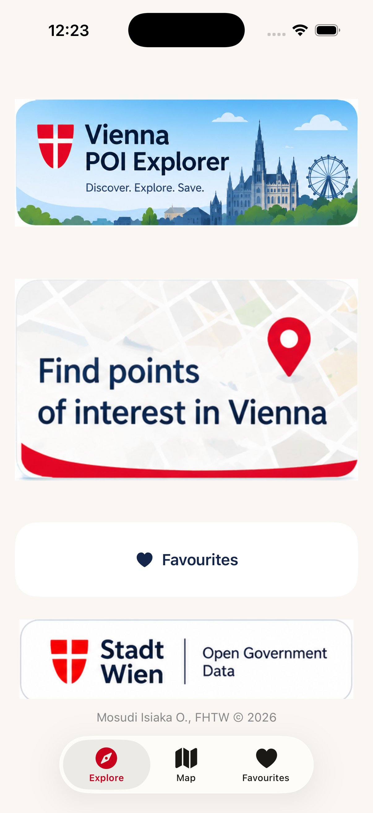 | 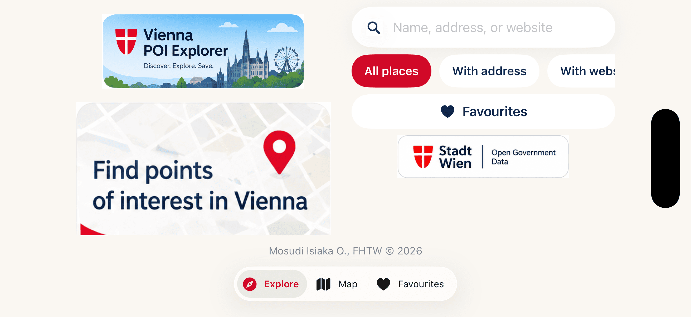 |

### Places catalogue

| Places list | Landscape list and map |
|---|---|
| 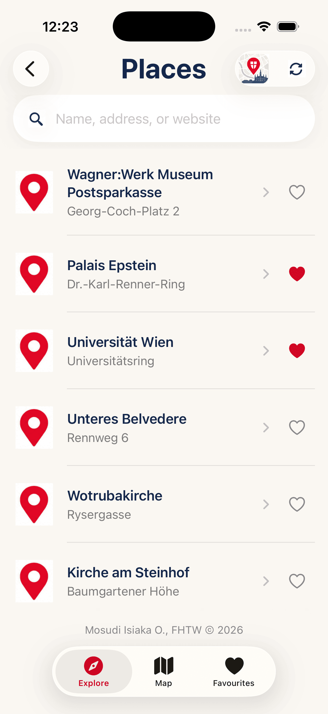 | 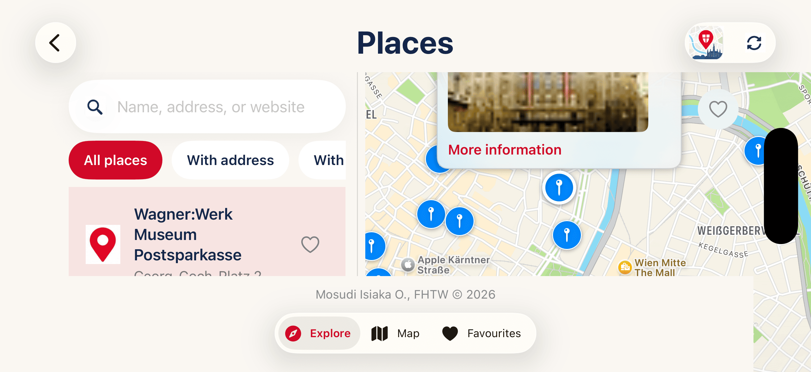 |

### Search results

| Search in portrait | Search beside map in landscape |
|---|---|
| 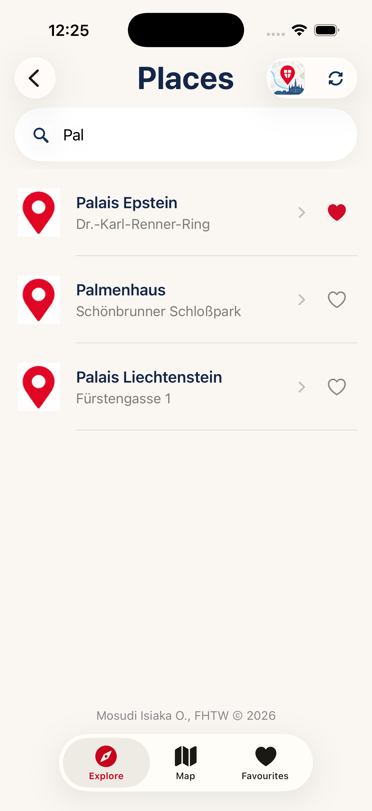 | 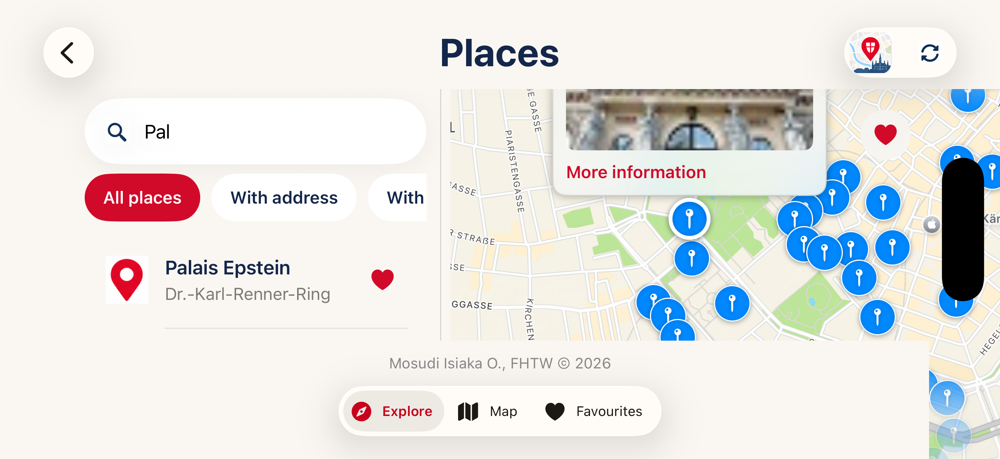 |

### Selected place on the map

| Portrait | Landscape |
|---|---|
| 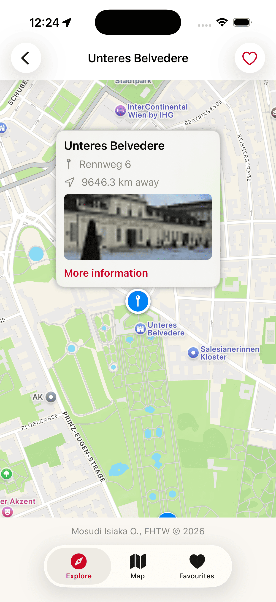 | 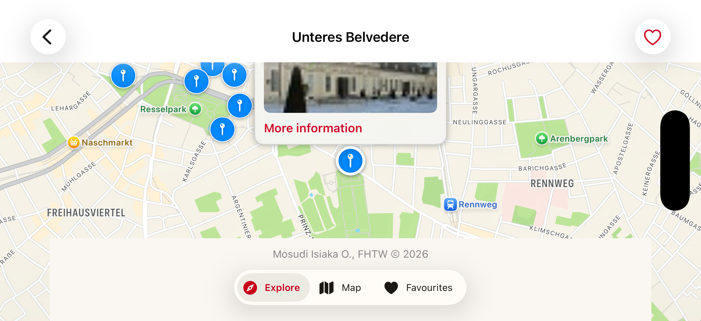 |

### Favourites

| Favourites in portrait | Favourites in landscape |
|---|---|
| 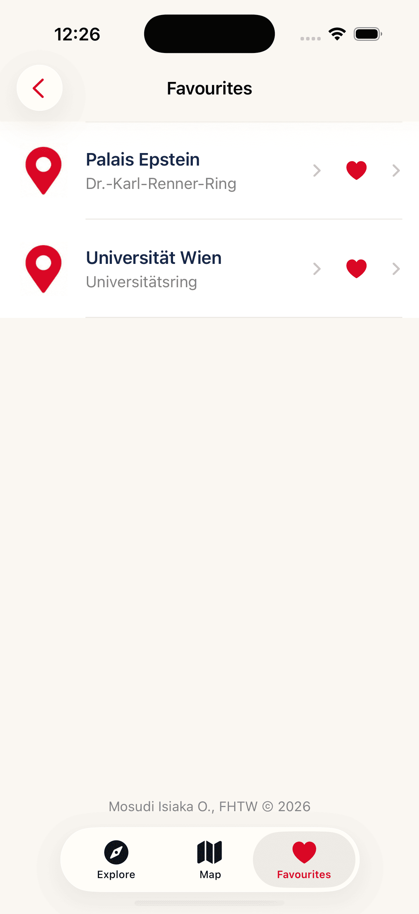 | 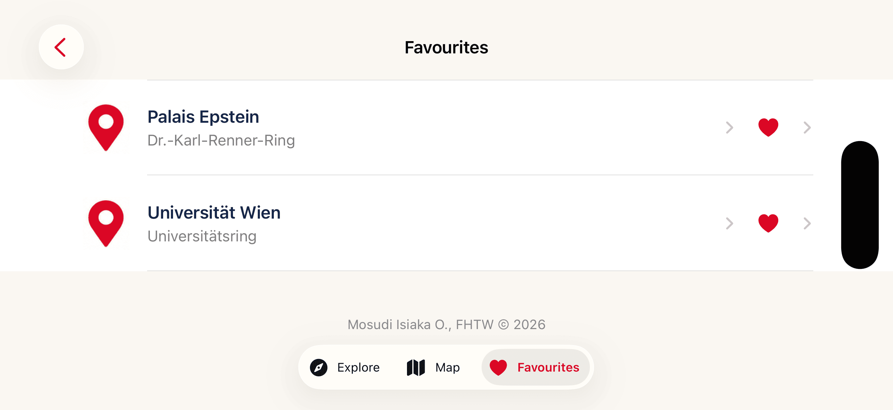 |

### Delete confirmation

| Portrait | Landscape |
|---|---|
| 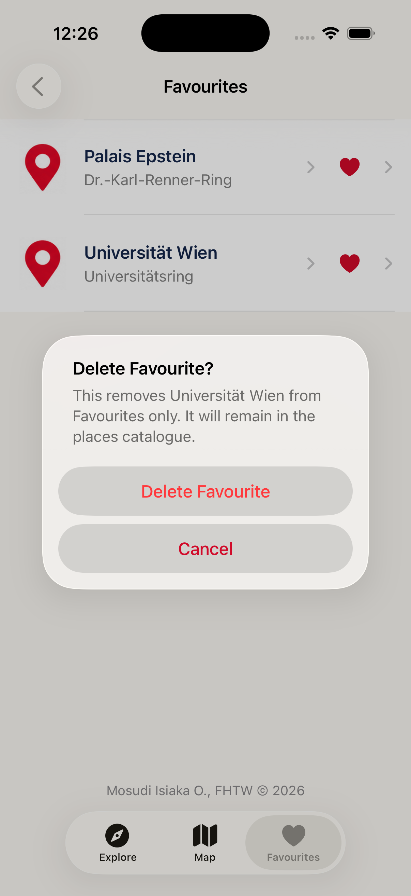 | 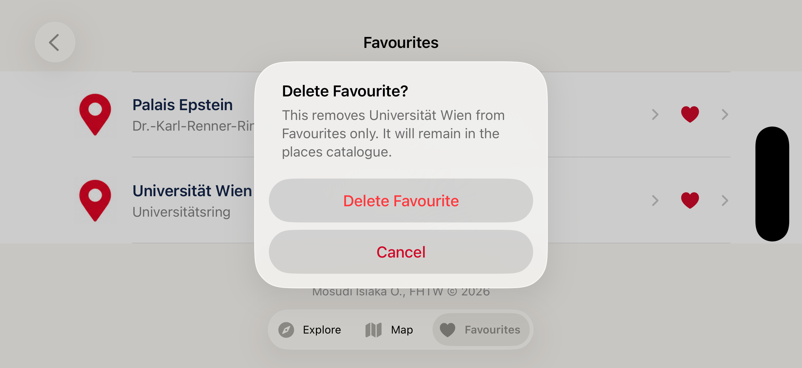 |

## Author

This iOS app and associated architectural artefacts are published under the open-source BSD 3-Clause Licence. Refer to the [LICENSE](https://github.com/imosudi/poi-vienna-explore/blob/main/LICENSE) file for comprehensive legal terms.

Copyright (c) 2026, Isiaka Mosudi, FHTW. All rights reserved.
