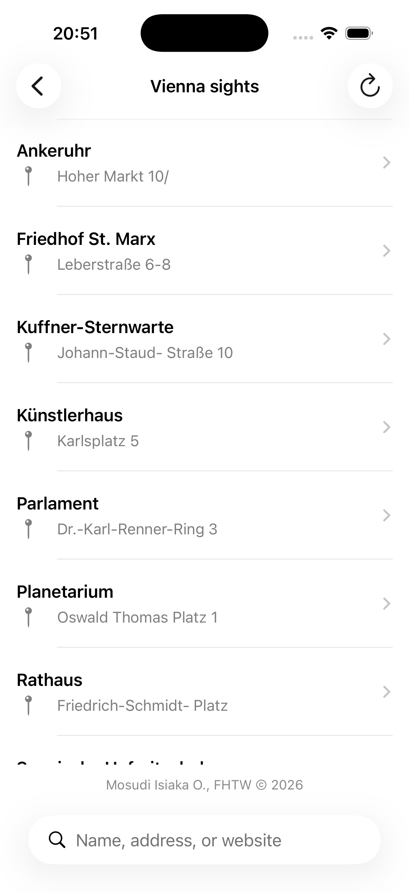
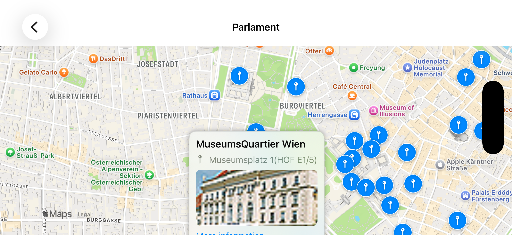
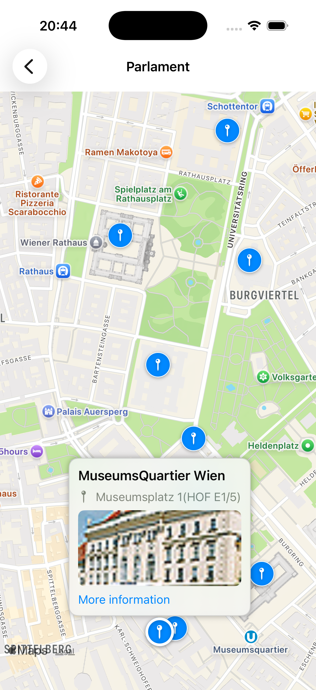

# Vienna POI Explorer

A native iOS app built with SwiftUI. The app loads Vienna sightseeing locations from the city's official open data service.

## Project structure

- `poi-vienna-explorer/App/` — app entry point
- `poi-vienna-explorer/AppState/` — catalogue loading state
- `poi-vienna-explorer/Models/` — domain models
- `poi-vienna-explorer/Services/` — data service interfaces
- `poi-vienna-explorer/Views/` — SwiftUI screens, including the POI map destination
- `poi-vienna-explorer/Assets.xcassets/` — app icon and categorized branding, icon, marker, and UI image sets
- `poi-vienna-explorerTests/` — unit tests
- `poi-vienna-explorerUITests/` — UI tests

Open `poi-vienna-explorer.xcodeproj` in Xcode and run the `poi-vienna-explorer` scheme on an iOS simulator or device. The deployment target is iOS 17.0.

## Branding assets

The supplied PNG crops are stored in the Xcode asset catalog under `Branding`, `Icons`, `Markers`, and `UI`. The home screen uses the Vienna POI Explorer banner, browse card, and City of Vienna Open Data badge; the refresh action and map callout use the supplied refresh and more-details graphics. Individual icons, category markers, status indicators, and their reference strips are retained as image sets for future screens.

The current sightseeing dataset does not identify transport, parking, charging, or operational availability, so those marker and status graphics are not used to classify map places. The app-icon crop is retained as branding artwork, but is not assigned to the platform `AppIcon` set: it is a small rounded raster crop rather than the full-bleed square artwork and required resolution needed for a production iOS app icon.

The app loads the dataset on launch and presents Explore, Map, and Saved tabs. Explore includes local search and quick filters for all places, places with addresses, and places with valid information websites; the Places list opens from Explore. These filters use only fields supplied by the dataset; it does not provide POI categories such as museums, churches, parks, or cafés. Searching and filtering do not issue additional requests. Select a place to open a MapKit view centered on that location. Save or remove a POI from its list row or map using the heart button; saved records, keyed by their stable dataset ID, are stored as versioned JSON in the app's Application Support directory and are available after relaunch without a network response. The map requests location access only while in use, displays the user's location when authorized, and shows the distance to the selected place. Location updates stop when leaving the map; the app does not request background location access. Map annotations are selectable and show the place name plus available address, thumbnail, distance, and information link. Markers are blue when the dataset provides a valid information link and neutral gray when it does not; a white outline highlights the selected marker. The dataset has no operational-status field, so marker colour does not imply availability. Use the Refresh button or pull down on the list to request updated records. A failed refresh leaves the previous results visible. Duplicate identifiers and records without usable names or coordinates are omitted.

## Vienna places data

The app loads the City of Vienna dataset [Sehenswürdigkeiten Standorte Wien](https://www.data.gv.at/katalog/datasets/f4e80988-c139-4953-8176-b3d6d03f6449) from its published [WFS GeoJSON distribution](https://data.wien.gv.at/daten/geo?service=WFS&request=GetFeature&version=1.1.0&typeName=ogdwien%3ASEHENSWUERDIGOGD&srsName=EPSG%3A4326&outputFormat=json). The response is a GeoJSON `FeatureCollection` of `Point` features. The app maps `id` (falling back to `properties.OBJECTID`), `properties.NAME`, `ADRESSE`, `WEITERE_INF`, and `THUMBNAIL`; coordinates are ordered longitude then latitude.

Features without a stable identifier, a non-empty name, a `Point` geometry, or finite in-range coordinates are skipped instead of becoming invalid map/list entries. Missing descriptive values remain optional, invalid optional web links are omitted, and extra coordinate dimensions are ignored. Marker colour reflects only whether a valid `WEITERE_INF` link is present. The sample fixture in `poi-vienna-explorerTests/Fixtures/` contains unmodified records from the official response, including its nullable `SE_ANNO_CAD_DATA` field.

## Screenshots

### Home screen

### POI map

 