# Vienna POI Explorer

A native iOS app built with SwiftUI. The app loads Vienna sightseeing locations from the city's official open data service.

## Project structure

- `poi-vienna-explorer/App/` — app entry point
- `poi-vienna-explorer/AppState/` — catalogue loading state
- `poi-vienna-explorer/Models/` — domain models
- `poi-vienna-explorer/Services/` — data service interfaces
- `poi-vienna-explorer/Views/` — SwiftUI screens, including the POI map destination
- `poi-vienna-explorer/Assets.xcassets/` — app icon and categorized branding, icon, marker, and UI image sets
- `poi-vienna-explorerTests/` — unit tests
- `poi-vienna-explorerUITests/` — UI tests

Open `poi-vienna-explorer.xcodeproj` in Xcode and run the `poi-vienna-explorer` scheme on an iOS simulator or device. The deployment target is iOS 17.0.

## Branding assets

The supplied PNG crops are stored in the Xcode asset catalog under `Branding`, `Icons`, `Markers`, and `UI`. The home screen uses the Vienna POI Explorer banner, browse card, and City of Vienna Open Data badge; the refresh action and map callout use the supplied refresh and more-details graphics. Individual icons, category markers, status indicators, and their reference strips are retained as image sets for future screens.

The current sightseeing dataset does not identify transport, parking, charging, or operational availability, so those marker and status graphics are not used to classify map places. The app-icon crop is retained as branding artwork, but is not assigned to the platform `AppIcon` set: it is a small rounded raster crop rather than the full-bleed square artwork and required resolution needed for a production iOS app icon.

The app loads the dataset on launch and presents Explore, Map, and Favourites tabs. Explore adapts to orientation: portrait uses a compact, non-scrolling home layout, while landscape places branding and the browse card beside search, dataset-backed filters, and Favourites. The Places screen also adapts to orientation: portrait pushes the selected POI map, while landscape keeps the searchable, filterable places list beside a map centered on the selected POI. Quick filters cover all places, places with addresses, and places with valid information websites. These filters use only fields supplied by the dataset; it does not provide POI categories such as museums, churches, parks, or cafés. Searching and filtering do not issue additional requests. Pushed screens provide back navigation, and Favourites has a Back button to return to Explore. Select “Add Favourite” to save a POI. Removing a saved entry is labelled “Delete Favourite” and asks for confirmation with “Cancel” or “Delete Favourite”; the confirmation explains that only the saved entry is removed, not the catalogue POI. Saved records, keyed by their stable dataset ID, are stored as versioned JSON in the app's Application Support directory and are available after relaunch without a network response. Favourites reload from persistent storage when their tab appears, and saved places remain viewable and mappable when the live dataset cannot be loaded. The map requests location access only while in use, displays the user's location when authorized, and shows the distance to the selected place. Location updates stop when leaving the map; the app does not request background location access. Map annotations are selectable and show the place name plus available address, thumbnail, distance, and information link. Markers are blue when the dataset provides a valid information link and neutral gray when it does not; a white outline highlights the selected marker. The dataset has no operational-status field, so marker colour does not imply availability. Use the Refresh button or pull down on the list to request updated records. A failed refresh leaves the previous results visible. Duplicate identifiers and records without usable names or coordinates are omitted.

## Vienna places data

The app loads the City of Vienna dataset [Sehenswürdigkeiten Standorte Wien](https://www.data.gv.at/katalog/datasets/f4e80988-c139-4953-8176-b3d6d03f6449) from its published [WFS GeoJSON distribution](https://data.wien.gv.at/daten/geo?service=WFS&request=GetFeature&version=1.1.0&typeName=ogdwien%3ASEHENSWUERDIGOGD&srsName=EPSG%3A4326&outputFormat=json). The response is a GeoJSON `FeatureCollection` of `Point` features. The app maps `id` (falling back to `properties.OBJECTID`), `properties.NAME`, `ADRESSE`, `WEITERE_INF`, and `THUMBNAIL`; coordinates are ordered longitude then latitude.

Features without a stable identifier, a non-empty name, a `Point` geometry, or finite in-range coordinates are skipped instead of becoming invalid map/list entries. Missing descriptive values remain optional, invalid optional web links are omitted, and extra coordinate dimensions are ignored. Marker colour reflects only whether a valid `WEITERE_INF` link is present. The sample fixture in `poi-vienna-explorerTests/Fixtures/` contains unmodified records from the official response, including its nullable `SE_ANNO_CAD_DATA` field.

## Screenshots

Screenshots are iOS captures. The list, map, and saved-favourite content may
vary with the dataset and favourites present when the capture was made.

### Explore home

| Portrait | Landscape |
|---|---|
| 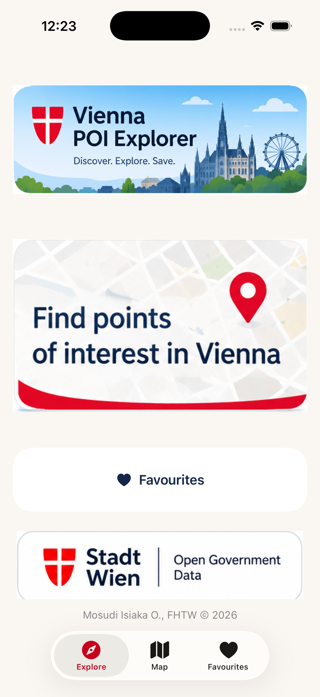 | 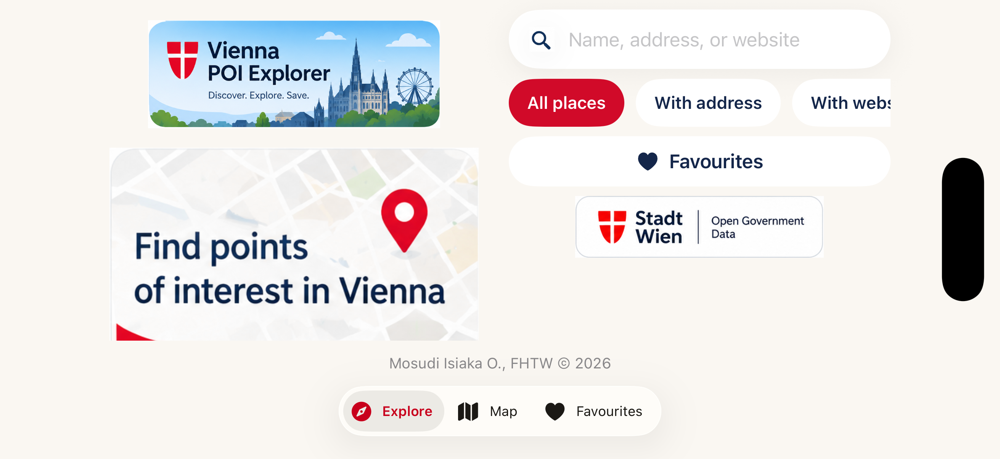 |

### Places catalogue

| Places list | Landscape list and map |
|---|---|
| 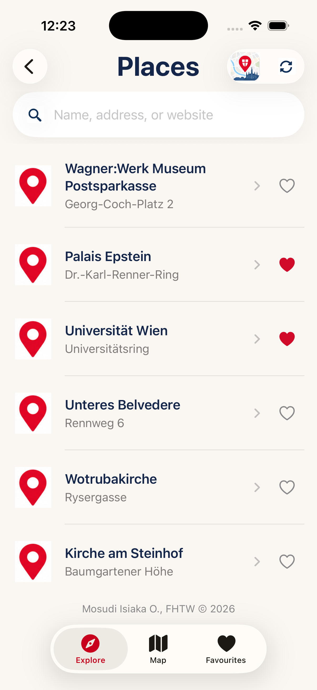 | 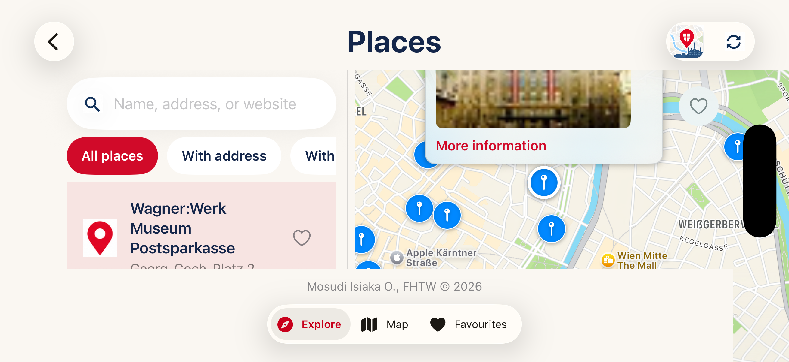 |

### Search results

| Search in portrait | Search beside map in landscape |
|---|---|
| 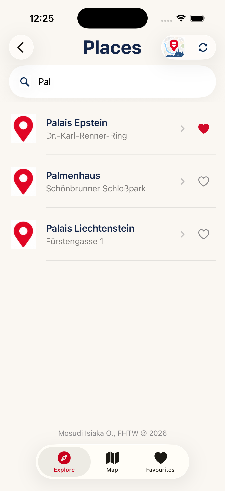 | 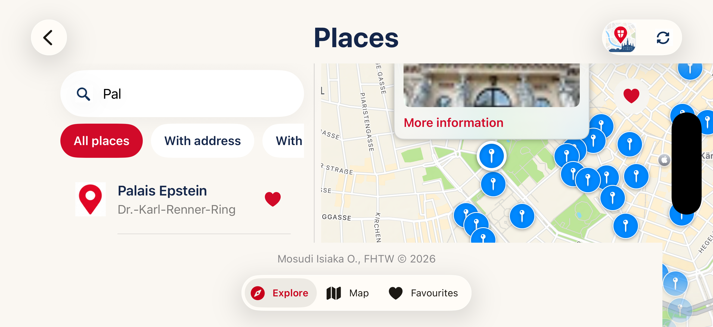 |

### Selected place on the map

| Portrait | Landscape |
|---|---|
| 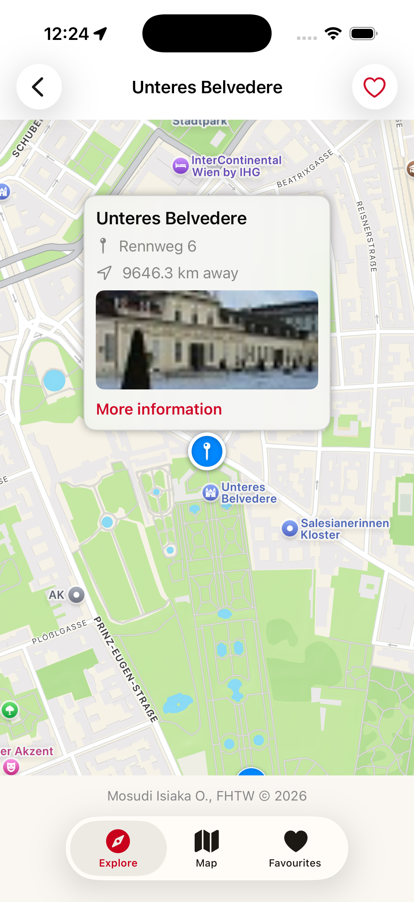 | 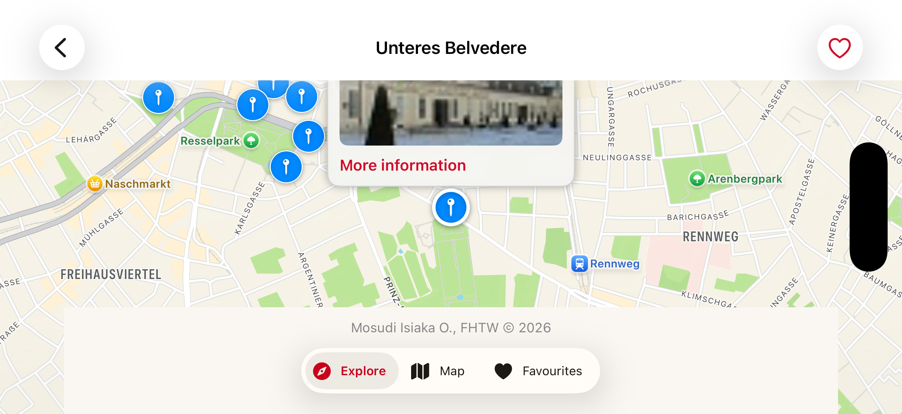 |

### Favourites

| Favourites in portrait | Favourites in landscape |
|---|---|
| 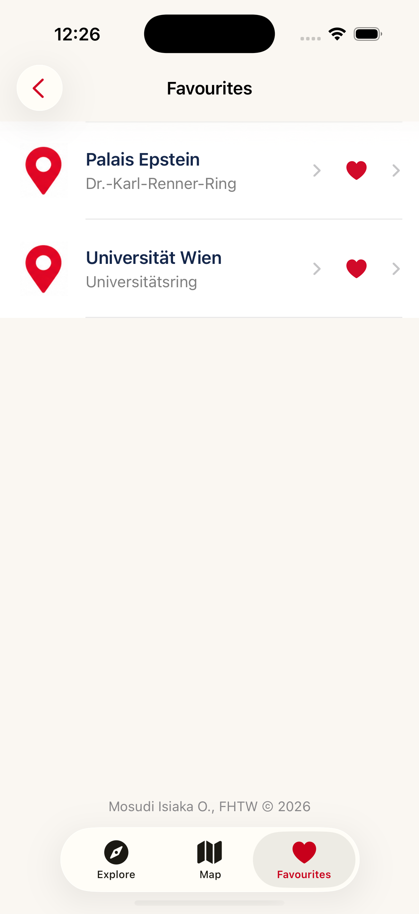 | 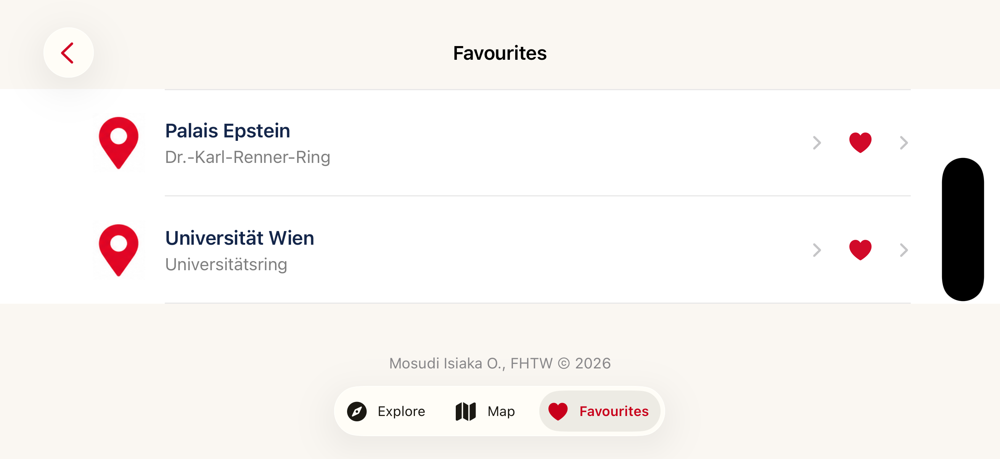 |

### Delete confirmation

| Portrait | Landscape |
|---|---|
| 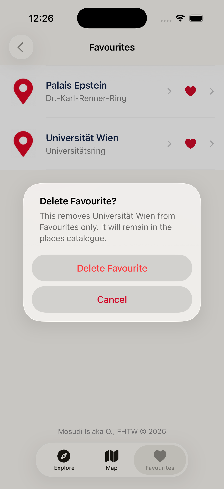 | 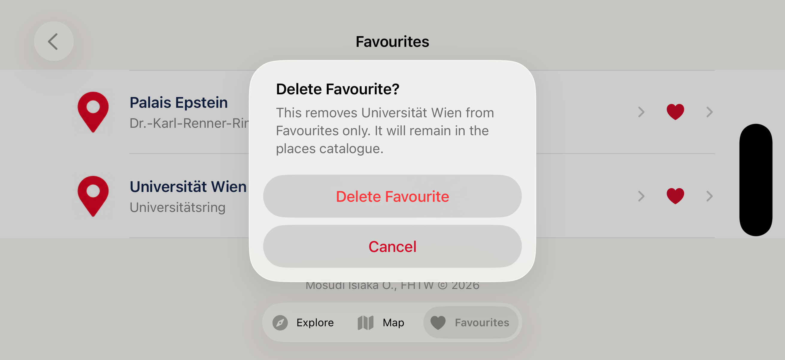 |

 