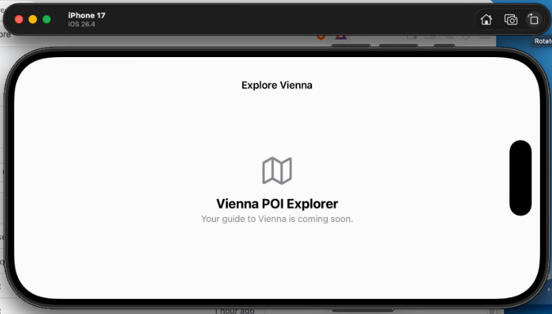

# Vienna POI Explorer

A native iOS app built with SwiftUI. The app loads Vienna sightseeing locations from the city's official open data service.

## Project structure

- `poi-vienna-explorer/App/` — app entry point
- `poi-vienna-explorer/AppState/` — catalogue loading state
- `poi-vienna-explorer/Models/` — domain models
- `poi-vienna-explorer/Services/` — data service interfaces
- `poi-vienna-explorer/Views/` — SwiftUI screens
- `poi-vienna-explorer/Assets.xcassets/` — app assets
- `poi-vienna-explorerTests/` — unit tests
- `poi-vienna-explorerUITests/` — UI tests

Open `poi-vienna-explorer.xcodeproj` in Xcode and run the `poi-vienna-explorer` scheme on an iOS simulator or device. The deployment target is iOS 17.0.

The app starts loading the dataset on launch, and the home screen links to the sights catalogue. The catalogue filters loaded names, addresses, and information links locally as you type; changing the search text does not issue additional requests. Use the Refresh button or pull down on the list to request updated records. A failed refresh leaves the previous results visible. Duplicate identifiers and records without usable names or coordinates are omitted.

## Vienna places data

The app loads the City of Vienna dataset [Sehenswürdigkeiten Standorte Wien](https://www.data.gv.at/katalog/datasets/f4e80988-c139-4953-8176-b3d6d03f6449) from its published [WFS GeoJSON distribution](https://data.wien.gv.at/daten/geo?service=WFS&request=GetFeature&version=1.1.0&typeName=ogdwien%3ASEHENSWUERDIGOGD&srsName=EPSG%3A4326&outputFormat=json). The response is a GeoJSON `FeatureCollection` of `Point` features. The app maps `id` (falling back to `properties.OBJECTID`), `properties.NAME`, `ADRESSE`, `WEITERE_INF`, and `THUMBNAIL`; coordinates are ordered longitude then latitude.

Features without a stable identifier, a non-empty name, a `Point` geometry, or finite in-range coordinates are skipped instead of becoming invalid map/list entries. Missing descriptive values remain optional, invalid optional web links are omitted, and extra coordinate dimensions are ignored. The sample fixture in `poi-vienna-explorerTests/Fixtures/` contains unmodified records from the official response, including its nullable `SE_ANNO_CAD_DATA` field.

## Debug screenshot

Portrait:

Landscape:

